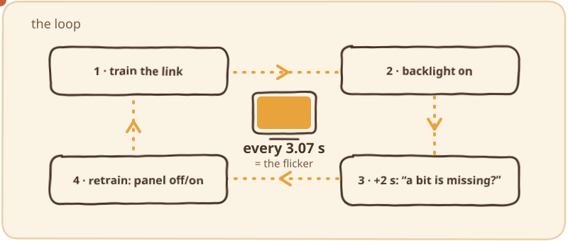
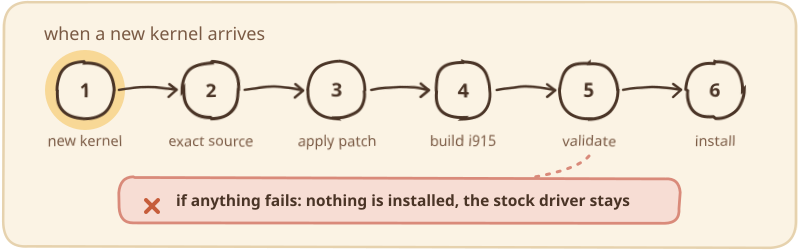

<p align="center">
  
</p>

A local workaround for an **intermittent internal-screen flicker** on Intel laptops: after boot (login screen and desktop) the built-in panel blanks and comes back every ~3 s, 5–11 times, and then stops by itself. It can also be triggered on demand by changing the refresh rate.

It was found and fixed on an **MSI Prestige 16Studio A13VF** (Intel Raptor Lake-P `8086:a7a0`, AUO `B160QAN02.K` 2560×1600@165 Hz eDP panel), Ubuntu 26.04, kernel `7.0.0-42-generic`. The usual suspects (PSR, Panel Replay, DC states, FBC, link rate, brightness, NVIDIA power management, refresh rate) made **no difference**. The cause turned out to be a single DPCD bit.


## ⚠️ Read this first

- **This is an unofficial, local workaround, not an upstream fix, and it has been tested on one machine only.**
- It **builds and installs an unsigned kernel module as root**.
- Unless you pass `--no-auto`, it also installs a kernel hook and a boot service that do so **automatically and unattended** on every kernel update (~260 MB download + build).
- A bad module can leave you **without the graphics driver**. It is recoverable, but make sure you can open GRUB and reach a root shell *before* you start (see [Undo / recovery](#undo--recovery)), and **read the scripts before running them as root**.
- It **ignores one DPCD bit (`INTERLANE_ALIGN_DONE`) on *every* eDP panel** of the machine. Only apply it if the diagnosis below matches your symptoms. It will not help, and could hide a real problem, if your link is genuinely unstable.
- **Scope:** x86_64, **Ubuntu**, stock **`-generic` kernels built from the `linux` source package**; tested only on Ubuntu 26.04 with `7.0.0-42-generic`. **Not supported:** other distributions, HWE/OEM/lowlatency/cloud kernels, the `xe` driver, machines where `i915` is inside the initramfs (check first: `lsinitramfs /boot/initrd.img-$(uname -r) | grep -c 'gpu/drm/i915/i915\.ko'` must print `0`; the installer checks this and refuses otherwise), boot loaders other than GRUB (for the diagnosis helpers). On other kernel versions the patch may refuse to apply, in which case nothing is installed.
- **Secure Boot / kernel lockdown must be off.** An unsigned module will not load otherwise; the installer refuses to run and the rebuild refuses to install. If you enable Secure Boot *after* installing, the override will fail to load with no automatic fallback: run `sudo i915-patch-remove` first.
- **What it changes:** `/usr/local/sbin/i915-patch-{rebuild,status,remove}`, `/usr/local/share/i915-patch/`, `/var/lib/i915-patch/`, `/var/log/i915-patch.log`, `/lib/modules/<kver>/updates/i915.ko`, `/var/cache/i915-patch/` (~250 MB: the source of the most recent kernel stays cached, older ones are pruned after a successful install, and a failed build leaves it there; `i915-patch-remove --all` deletes it), and with automation also `/etc/kernel/postinst.d/zz-i915-patch` and `/etc/systemd/system/i915-patch-catchup.service`.
- Your kernel will show as **tainted** (unsigned out-of-tree module); kernel developers will ask you to reproduce without it. MIT-licensed, **no warranty**.

## Is this your bug? (read-only diagnosis)

<p align="center"></p>

i915 trains the eDP link successfully, and ~2 s later its post-training link recheck decides the link is bad and retrains it (a full panel power cycle: that is the flicker) **even though every lane reports lock**. Only one bit is missing:

<p align="center"></p>

```bash
sudo bash diagnose/flicker-debug-on.sh     # adds drm.debug=0x106 log_buf_len=32M via /etc/default/grub.d (reversible; GRUB only)
# reboot, repeat until the screen flickers, then:
bash diagnose/diagnose.sh                  # add sudo if journalctl -k is not readable by your user
sudo bash diagnose/flicker-debug-off.sh    # when you are done; reboot
```

`log_buf_len=32M` reserves 32 MiB of RAM and `drm.debug=0x106` writes many MB of journal per boot, so turn it off once you have a flickering boot captured, and review the logs before posting them anywhere (they can contain monitor identifiers and your hostname).

`diagnose.sh` exit codes:

| Code | Meaning |
|---|---|
| `0` | **THE SIGNATURE MATCHES**: this repo probably fixes your case |
| `5` | retrains with **other** symptoms: this fix is **not** for you |
| `1` | no retrains in that boot (also the expected result after a successful fix) |
| `3` | no `drm.debug` data in that boot |
| `4` | retrains seen but no link-status dump: cannot classify |
| `2` | bad arguments, or the journal is not readable (retry with `sudo`) |

How it was found, with all the measurements: [docs/INVESTIGATION.md](docs/INVESTIGATION.md).

## Apply

```bash
sudo apt install build-essential python3 patch "linux-headers-$(uname -r)" linux-headers-generic
sudo bash scripts/install.sh      # prompts for confirmation (type YES); --no-auto skips the kernel hook and the boot service
sudo i915-patch-rebuild           # downloads ~260 MB of kernel source, builds, validates and installs for the RUNNING kernel
i915-patch-status                 # BEFORE rebooting: your running kernel must say PATCHED
sudo reboot
```

`linux-headers-generic` keeps the headers of future kernels coming in; the automatic rebuild needs them.

`i915-patch-rebuild` exits 0 even when it deliberately installs nothing (for example Secure Boot is on), so always check `i915-patch-status` and `/var/log/i915-patch.log`. After rebooting, `modinfo -n i915` must end in `/updates/i915.ko`, and `/sys/module/i915/srcversion` must match the one `i915-patch-status` shows for the patched module. For a dry run that builds and validates but installs nothing: `sudo env BUILD_ONLY=1 i915-patch-rebuild`.

## Results

<p align="center"></p>

After the patch, three consecutive boots had 1 link training and 0 retrains each, and the picture stayed clean. That suggests the panel is not really losing alignment and simply reports the bit as zero (not proven).

## What happens on kernel updates

<p align="center"></p>

With automation enabled, a kernel `postinst` hook starts `i915-patch-rebuild` in the background for the new kernel: it downloads **that kernel's exact source** (apt, signed by the Ubuntu keyring, hashes re-checked against the `.dsc`), applies Ubuntu's diff and the one-hunk patch (no fuzz), builds only `i915` against that kernel's headers, validates it (identical vermagic, identical modversion CRCs against the stock module, different srcversion) and only then installs it atomically (with `fsync`) into `/lib/modules/<kver>/updates/`.

If **anything** fails (no network, the i915 source changed and the patch no longer applies, an unsupported kernel flavour, …) it installs **nothing**: that kernel keeps the stock driver and the flicker may come back. The install itself is atomic and fsynced, so a power cut in the middle does not leave a half-written module. What this does **not** protect you from: enabling Secure Boot/lockdown *after* the module is installed (an unsigned module fails to load, with no automatic fallback to the stock one), and a module that passes validation but misbehaves at runtime (validation checks ABI compatibility, not behaviour).

A boot-time service retries, but only when the booted kernel is the **newest installed** one and has no override yet (for example the job was interrupted, or there was no network), and not within 6 h of a failed or skipped attempt; its result takes effect at the next reboot. **Run `i915-patch-status` after every kernel update, before rebooting.**

Why not a plain DKMS? `i915` is part of the kernel: a frozen copy of its source built against a *different* kernel may fail to build or, worse, load and misbehave.

## Undo / recovery

```bash
sudo i915-patch-remove          # removes the patched modules THIS TOOL installed, from all kernels, and disables the automation; then reboot
sudo i915-patch-remove --all    # also uninstalls the hook, the boot service, the cache and the scripts (except i915-patch-remove itself)
```

After rebooting, `modinfo -n i915` must print a path under `.../kernel/drivers/gpu/drm/i915/`, not `.../updates/`. To patch again later, run `sudo bash scripts/install.sh` (this clears the `disabled` flag and re-enables the automation), then `sudo i915-patch-rebuild`.

If the screen is wrong or black after a reboot:

1. Switch to a text console (`Ctrl+Alt+F3`), log in, run `sudo i915-patch-remove`, then `sudo reboot`. If it prints `SKIPPED`, run `sudo FORCE_ALL=1 i915-patch-remove` instead.
2. With no console, open the GRUB menu (hold `Shift` right after power-on on BIOS systems, tap `Esc` on UEFI) and either
   - pick **Advanced options** and a kernel with no override (`i915-patch-status` lists them; only kernels installed *before* you set this up are unpatched, every kernel installed later gets patched, and Ubuntu removes old kernels over time, so do not count on having one; to keep one: `sudo apt-mark manual linux-image-<ver>-generic linux-modules-<ver>-generic`), or
   - the most reliable way: **Advanced options → a (recovery mode) entry → root shell**, then `mount -o remount,rw /`, `/usr/local/sbin/i915-patch-remove`, `reboot`.
3. By hand. This does **not** stop the automation, so disable it first or the next boot will rebuild what you removed: `sudo mkdir -p /var/lib/i915-patch && sudo touch /var/lib/i915-patch/disabled && sudo rm /lib/modules/$(uname -r)/updates/i915.ko && sudo depmod -a $(uname -r)`.

`i915-patch-remove` only removes modules this tool installed (they have an ownership marker in `/var/lib/i915-patch`); `sudo FORCE_ALL=1 i915-patch-remove` removes any `updates/i915.ko`. To delete every trace after `--all`: `sudo rm -rf /var/lib/i915-patch /var/log/i915-patch.log /usr/local/sbin/i915-patch-remove`.

## Tests

`bash tests/run-tests.sh` needs no root and touches nothing: it checks script syntax, the diagnosis classifier against five synthetic sample logs, and that the patch applies without fuzz to a small stand-in file with the same function shape (not to real kernel source). It does **not** test the download, the build or the installation.

What was exercised on the author's machine (Ubuntu 26.04, `7.0.0-42-generic`) with the current revision of the scripts:

- **As root, 41 checks:** `install.sh` twice, a forced rebuild over an existing override, a no-op rebuild, the refusal to overwrite a module this tool did not install, `i915-patch-remove` (module removed, automation disabled, ownership marker cleared), the refusal to rebuild while disabled, a fresh rebuild with no override present, the GRUB debug helpers on and off, and the kernel hook starting a rebuild through systemd.
- **Without installing anything, 18 checks:** the full download from an empty cache with hash verification, patch, build and ABI validation, plus the failure paths: malformed kernel version, a patch that no longer applies, missing headers, a kernel without `i915`, a tampered tarball, a tampered Ubuntu diff, running without root, the `disabled` flag, the boot retry on a kernel that is not the newest, the back-off after a skipped attempt, and a symlinked log.

**Never exercised:** a real kernel update through `apt`, the boot-time retry service actually firing at boot, Secure Boot or lockdown being on (the guards were reviewed, and run only on a machine where both are off), any other distribution, kernel or hardware. The throw-away scripts used for these runs are not part of the repo.

## Upstream

No upstream bug has been filed by the author yet; a draft report with all the evidence is in [docs/UPSTREAM-REPORT-DRAFT.md](docs/UPSTREAM-REPORT-DRAFT.md). The proper fix is a sink/panel quirk in i915, in the spirit of the proposed "drm/i915/display: Add quirk for interlane align bit on CH7511" patch (different hardware). If you hit this bug, please open or add to an issue at <https://gitlab.freedesktop.org/drm/i915/kernel/-/issues> with your `diagnose.sh` output and your DPCD/panel data.

## License

MIT, see [LICENSE](LICENSE). `scripts/i915-ignore-interlane-align-edp.patch` is a small modification of `drivers/gpu/drm/i915/display/intel_dp.c` (Copyright Intel Corporation, MIT-style license header in that file) and is offered under the same terms as that file; the `i915.ko` you build is part of the Linux kernel (module license "GPL and additional rights").
